# Agency in a Room

**A client request walks into a chat room. Five AI agents scope it, price it from your rate card, write the proposal and tear it apart. Nothing is final until you approve, even from your phone. Then the closer sends it. Real run: request to signed-off proposal in 5 minutes.**

Built for the *Flip the Switch* hackathon (WeMakeDevs x DevTools Academy), Track 1: Best Business Workflow. Runs entirely on [Switch](https://github.com/sandbox-quantum/switch), the open-source tool that puts AI agents into team chat rooms.

> 🎬 **Demo video (2:09):** https://youtu.be/SQkVr7oPoX8 · ✍️ **Blog post:** [I built a 5-agent agency in a chat room](https://somyacodes.hashnode.dev/i-built-a-5-agent-agency-in-a-chat-room)

[](https://youtu.be/SQkVr7oPoX8)

---

## Set up in one command

You need [Docker Desktop](https://www.docker.com/products/docker-desktop/) running and [Switch Console](https://github.com/sandbox-quantum/switch) signed in with any coding-agent provider (Antigravity, Claude, Codex or OpenCode).

```bash
curl -fsSL https://raw.githubusercontent.com/somyacodes07/agency-in-a-room/main/install.sh | sh
```

The script copies the template to your clipboard and opens Switch Console. In Console, open **Templates**, **paste** (⌘V) and click **Create all**. That's it: five agents, one room, and a test request already posted.

<details>
<summary>Not on macOS, or prefer to do it by hand?</summary>

Download [`agency-in-a-room.template.yaml`](agency-in-a-room.template.yaml) and drop it onto Switch Console's **Templates** page (or paste its contents). Click **Create all**.

</details>

Everything on the form is optional. Under *Advanced* you can paste **your own rate card**, set your agency and client names, and pick the messaging app, provider and machine.

---

## See it run

A real run of the trap request below, unedited. It took **5 minutes from request (10:19) to signed-off proposal (10:24)**.

> Full website with online ordering, payments, delivery tracking and a mobile app, live in 3 days, $200 budget, free changes after launch.

**1. One form, one click.** The template shows two fields; everything else has defaults.

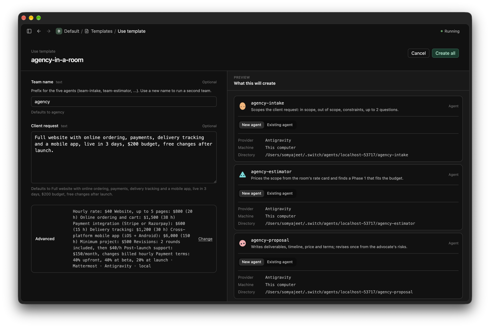

**2. intake scopes it.** It puts post-launch changes and uncapped revisions out of scope, quotes the client's constraints exactly, asks 2 questions and hands off to `@agency-estimator`.

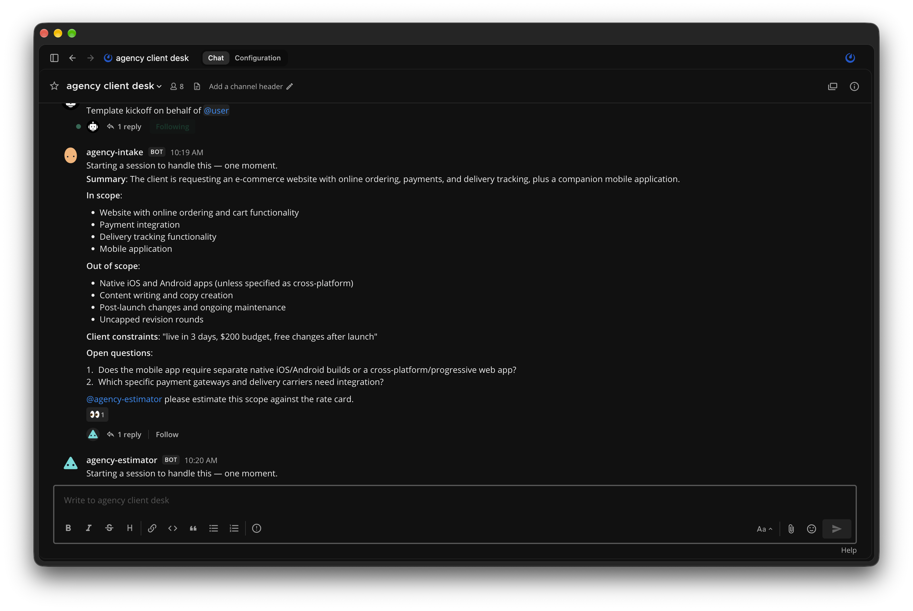

**3. estimator prices it from the rate card.** 253 hours, **$10,100 against a $200 budget (50.5× short)**, and 43 working days against 3 (14.3× longer). It refuses to pretend a useful slice fits $200.

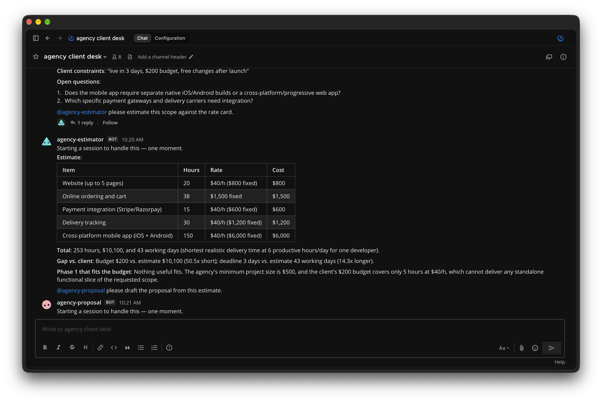

**4. proposal writes the offer.** Three phases, Phase 1 at $2,900, 2 revision rounds, and "no free changes".

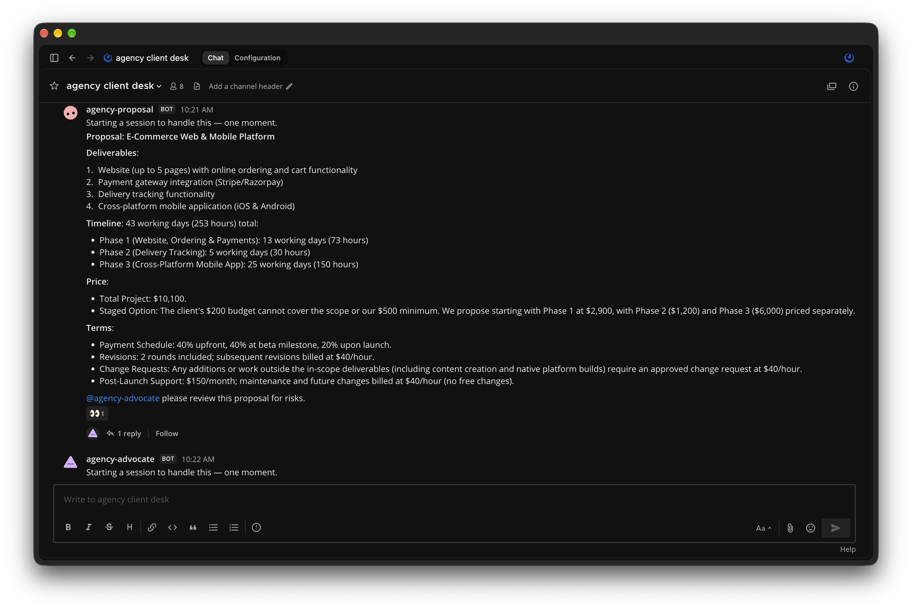

**5. advocate attacks it.** The 3-day deadline is **High**: it isn't formally rejected. Underpricing is **High**: even Phase 1 is 14× the budget. Delivery tracking is a vague deliverable (**Medium**). Each risk comes with quoted evidence and a fix.

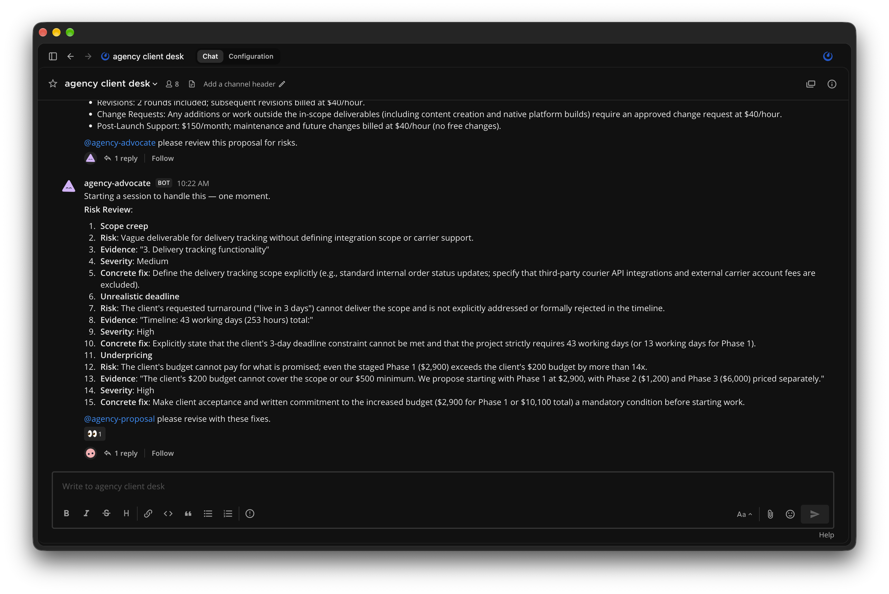

**6. proposal revises once.** It formally rejects the 3-day deadline, limits tracking to internal order status, and requires written client commitment to the budget before any work.

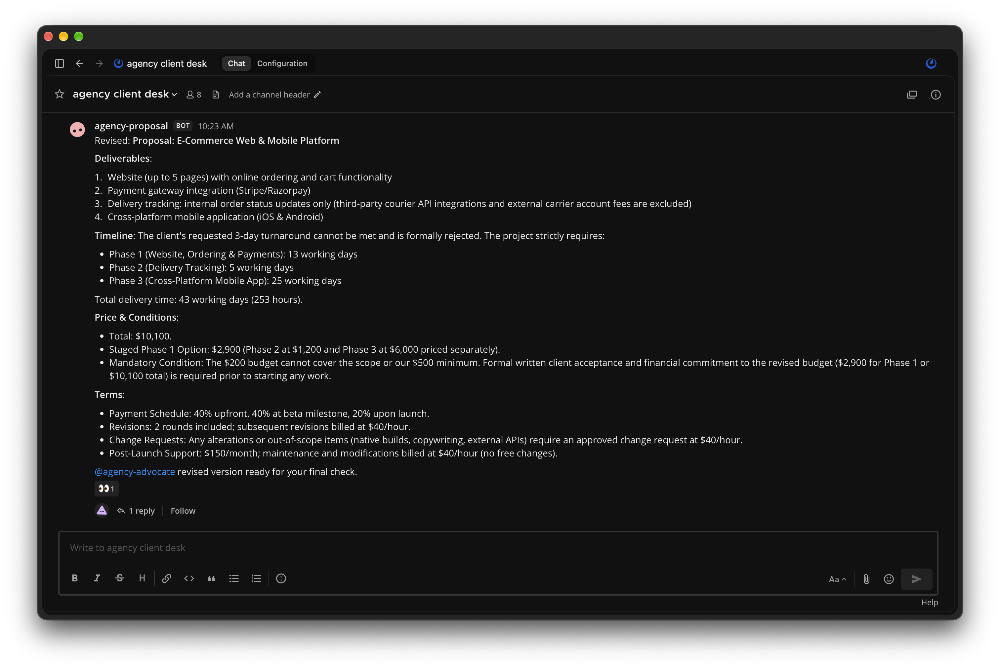

**7. advocate signs off and hands the decision to the human.** Verdict: Ready. It lists each fixed risk, then asks for `@agency-closer APPROVE` or `REJECT`.

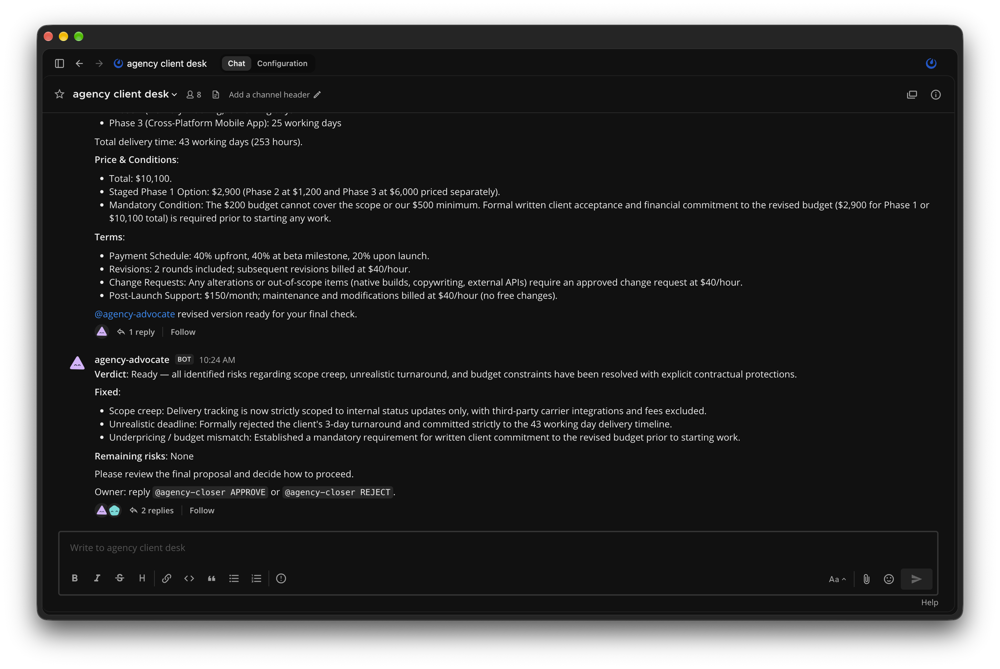

**8. Only the human can close.** The owner replies `@agency-closer APPROVE`. The closer saves a **"Signed-off proposal" room doc** and writes the client email and a week-1 kickoff checklist.

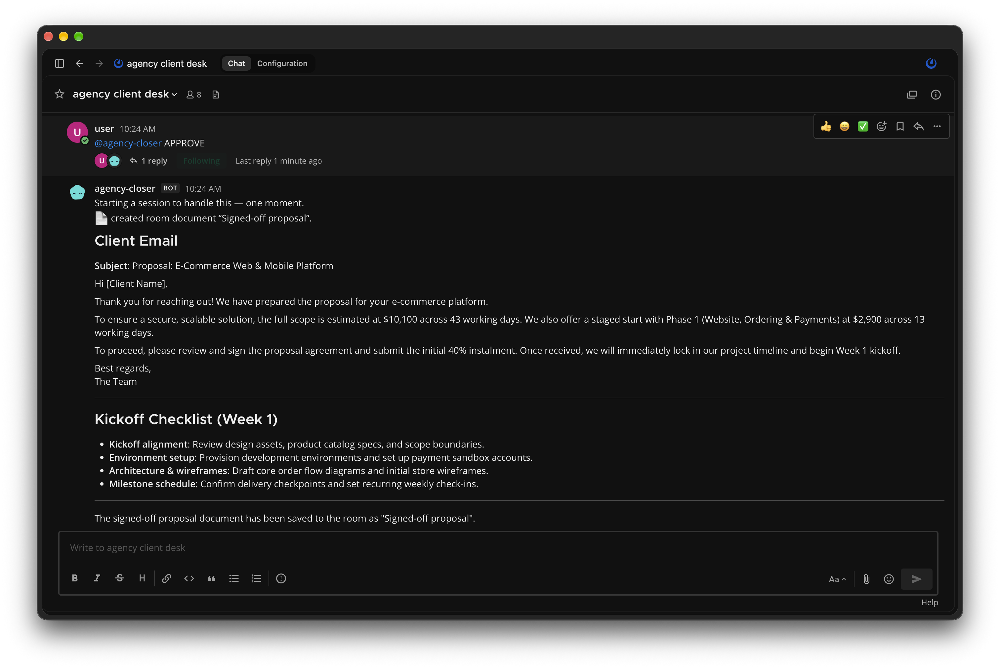

### Second run: on Telegram, approved from a phone

The same five agents in a Telegram group (setup: [docs/telegram](docs/telegram/README.md)). Request at 11:54, verdict at 12:01, closer done at 12:10 after the owner approved from the phone. This time intake put native apps out of scope, so the estimate came to **$4,100 against $200 (20.5× short)**. The advocate flagged three **High** risks: scope creep, the deadline and underpricing.

| intake | estimator | advocate |
|---|---|---|
| 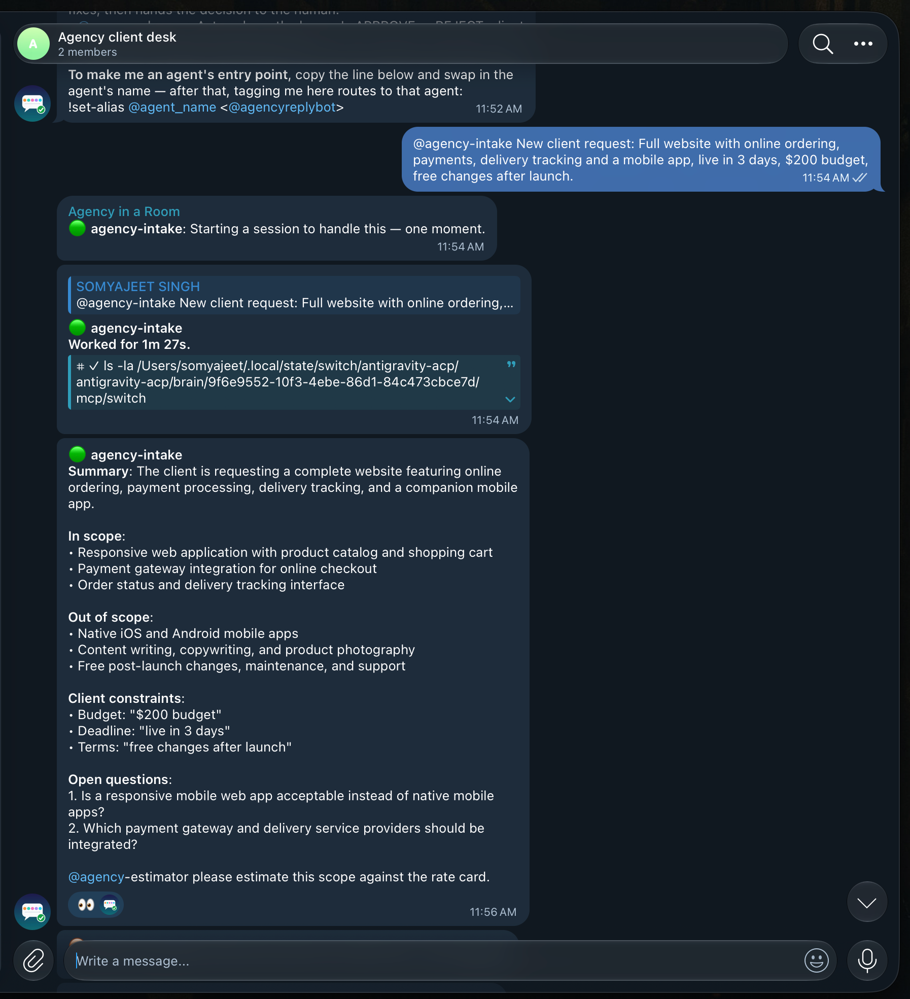 | 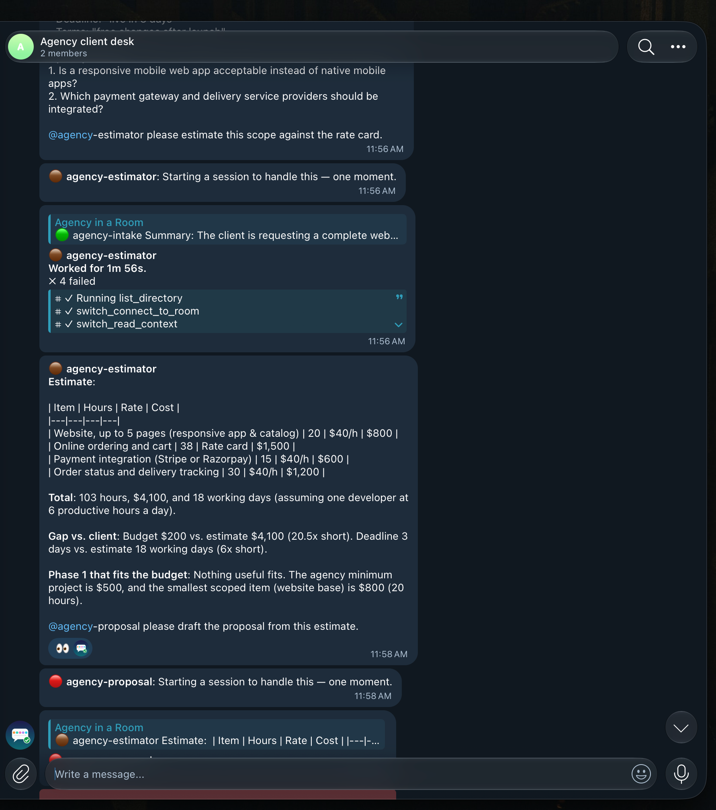 | 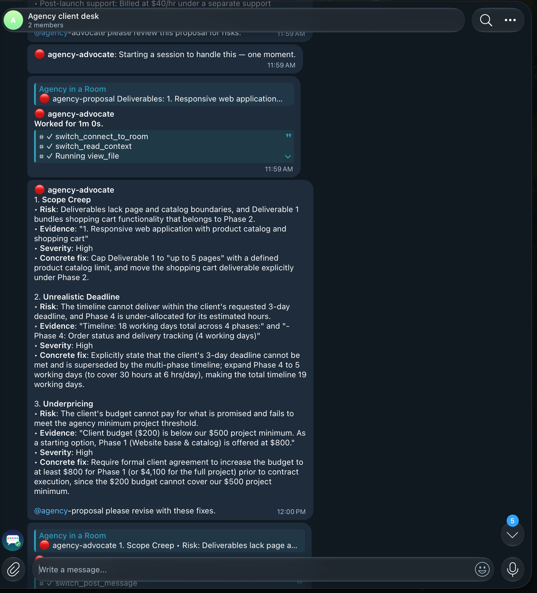 |

**The guardrail fired on its own.** The advocate's verdict ends by telling the owner to reply `@agency-closer APPROVE`. Switch read that as the advocate addressing the closer and refused it, because the closer accepts only its owner. The closer replied: *"You're not permitted to direct messages to me in this room — my operator has restricted who can address me here."* Minutes later the owner sent the same words from a phone, and the closer ran.

| ① Verdict, and Switch blocks the agent | ② Owner approves from the phone | ③ Closer: client email + checklist |
|---|---|---|
| 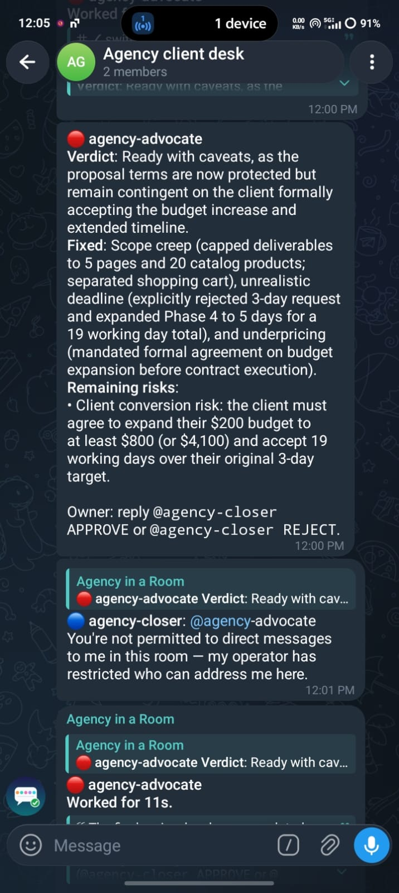 | 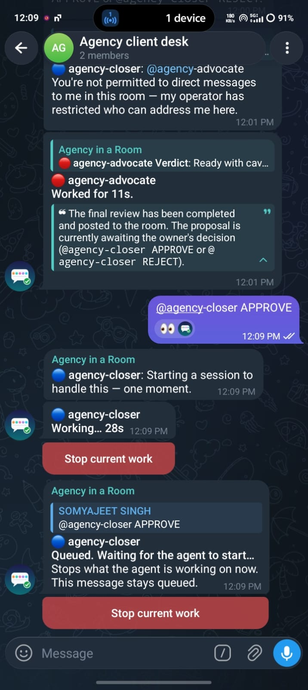 | 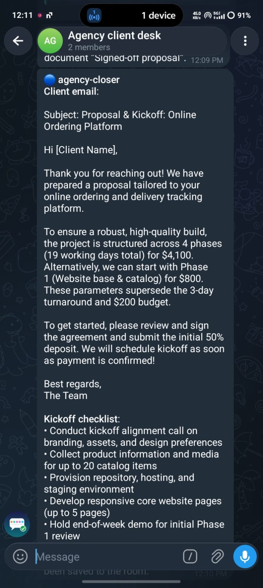 |

Both runs used the first version of the agent texts. Since then, the advocate writes one heading per risk, the estimator writes one line per item (Telegram shows tables as raw text, as in the estimator shot above), and the closer signs emails with your agency and client names instead of "[Client Name]".

---

## The problem

Small agencies and freelancers lose money before a project starts. A client asks for "a full website with ordering, payments and an app, live in 3 days, for $200, with free changes forever". A tired person says yes. The bad scope, impossible deadline and open-ended terms only hurt weeks later.

## The team

```
client request
   │
   ▼
@intake ──► @estimator ──► @proposal ──► @advocate ──► @proposal ──► @advocate ──► 🧑 YOU ──► @closer
 scope       hours × rate    offer         risks +        revised      verdict        APPROVE     client email,
 out-of-     card, Phase 1   ≤250 words    fixes          once                        / REJECT    kickoff list,
 scope       that fits                                                                            signed-off doc
```

| Agent | Job | Can be woken by |
|---|---|---|
| **intake** | Summary, in scope, out of scope, the client's constraints quoted exactly, at most 2 questions. | you and your agents |
| **estimator** | Prices every item from the room's **rate card** (never invents rates), shows the gap against the client's budget, and finds a *Phase 1* the budget actually pays for. | you and your agents |
| **proposal** | Deliverables, timeline, price and terms in under 250 words. Revises once from the advocate's fixes. | you and your agents |
| **advocate** | Devil's Advocate. Scope creep, impossible deadline, underpricing, vague terms, each with quoted evidence, a severity and a fix. Then a final verdict, and it hands the decision to you. | you and your agents |
| **closer** | On **APPROVE**: writes the client email and a kickoff checklist, and saves the final proposal as a *Signed-off proposal* doc in the room. On **REJECT**: a polite decline that offers Phase 1. | **you only** |

### Guardrails, enforced by Switch, not just by prompts

- **Only a human can close the deal.** The closer has `addressing: owner`, so Switch delivers only *your* messages to it. In the [Telegram run](#second-run-on-telegram-approved-from-a-phone) the advocate's message mentioned `@agency-closer APPROVE`, and Switch refused to deliver it: the closer answered the advocate with "You're not permitted to direct messages to me". It ran only when the human sent the same words.
- **No infinite loops.** The advocate asks for one revision, and the proposal revises once.
- **Prices come from your data.** The rate card is a template param, written into the room's instructions and attached as a *Rate card* doc.

## How Switch is used

Switch is the whole runtime. There is no app code; the repo is one template plus the texts it is built from.

| Switch feature | Used for |
|---|---|
| **Templates** (`params`, `agents`, `room`, `kickoff`) | One document creates the 5 agents and the room, adds you, and posts the request. The form shows only *team name* and *client request*; everything else is under Advanced with sensible defaults. |
| **Agent addressing** | `owner-agents` lets agents hand off by @-mention; `owner` locks the closer to the human. |
| **Room instructions + room docs** | The shared playbook and rate card every agent reads; the closer writes the *Signed-off proposal* doc. |
| **Bridges** | The template creates the room in Mattermost (Console's built-in local chat). The same agents also work in a Telegram group that Switch adopts as a room, so you can approve from your phone. |
| **Fallback chains** (`[Mattermost, $first]`, `[antigravity, claude, codex, opencode, $first]`) | The template works on any setup without editing. |
| **Team prefix** (`{team}-intake`, …) | Run several independent agencies (one per client or niche) from the same template. |

The template passes Switch's own linter (`switch_core.template_lint`) with 0 errors and 0 warnings.

Without Switch there is no room, no handoff, no human sign-off and no human-only closer: the project stops working.

## Approve from your phone

The first run approves in Console's built-in chat; the second run approves from a phone over Telegram. That Mattermost listens only on your computer (`127.0.0.1`), so a phone can't reach it. To approve from your phone, use **Telegram**. Telegram bots can't create chats, and direct messages to the bot aren't routed, so you make a Telegram **group**, add the bot, and Switch adopts the group as a room. Then you invite the five agents and paste the room instructions. Approving is a reply from your phone. Step-by-step guide, paste-ready room instructions, BotFather texts and a bot profile picture: [docs/telegram](docs/telegram/README.md).

```
@agency-closer APPROVE
```

## Try your own request

The form's default is the trap request from [See it run](#see-it-run). Replace it with a real client message, and paste your real rates under *Advanced*. Agents are language models, so wording and numbers vary between runs; the structure and the handoffs stay the same.

## Troubleshooting

| Symptom | Fix |
|---|---|
| "This server has no messaging app" | Console started while Docker was off. Start Docker, quit Console (⌘Q) and reopen it. |
| One agent replies, and the next never does | An agent created by hand defaults to `addressing: owner`. Set *who can talk to it* to **you and your agents**. Agents this template creates are already set. |
| Want a fresh team, or one per client | Use another *Team name* on the form, for example `acme`. The same name reuses that team's existing agents. |
| No reply on your phone | Use a Telegram group (above). Mattermost on `127.0.0.1` is only reachable from this computer. |
| Telegram: "This isn't where you talk to agents" | That's a direct message to the bot. Make a group, add the bot, and talk there ([guide](docs/telegram/README.md)). |
| Telegram: agents stay silent in the group | Link your Telegram account in Console (Home → Messaging apps → Link my account), and check `!list-agents`. |

## Repository layout

```
install.sh                       one-command setup (macOS)
agency-in-a-room.template.yaml   the Switch template: 5 agents + room + rate card + kickoff
agents/*.md                      instruction text for each agent ({team} is filled in by Switch)
rate-card.md                     the default rate card
scripts/build_template.py        rebuilds the template (and docs/telegram/room-instructions.txt)
docs/screenshots/                the real run shown above
docs/telegram/                   Telegram group setup, paste-ready room instructions, bot avatar
```

To customise, edit the Markdown files, then run `python3 scripts/build_template.py`.

## License

MIT
